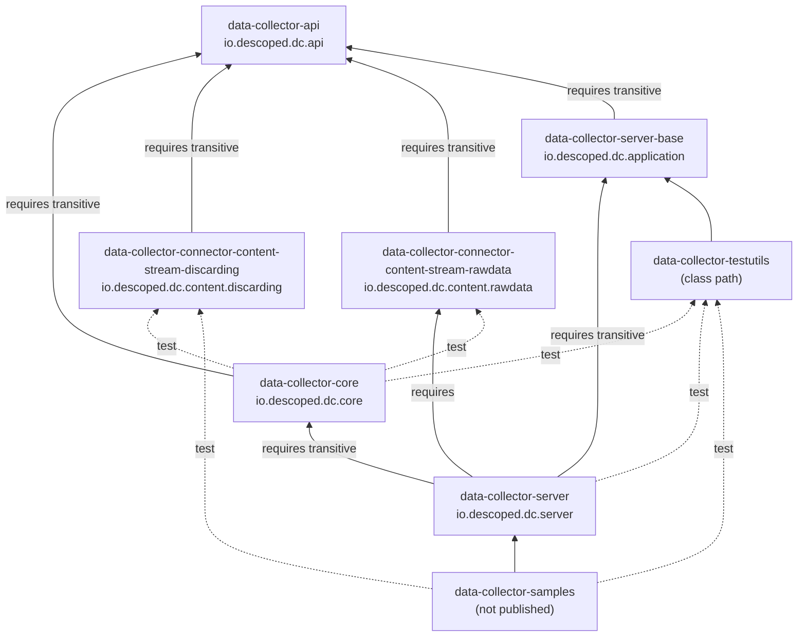
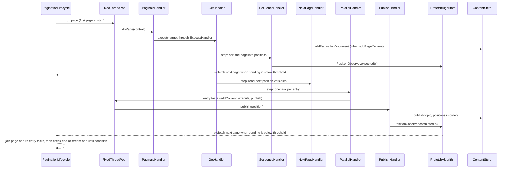
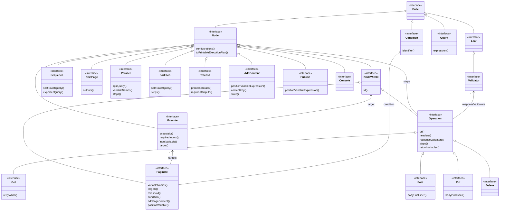
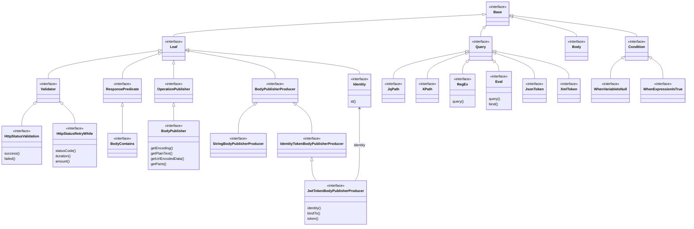
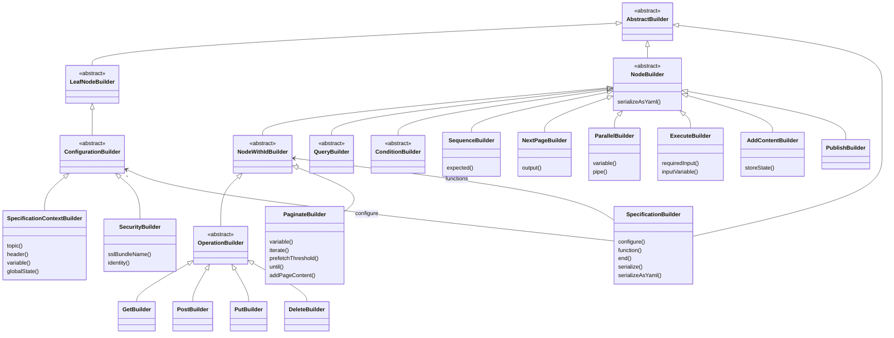
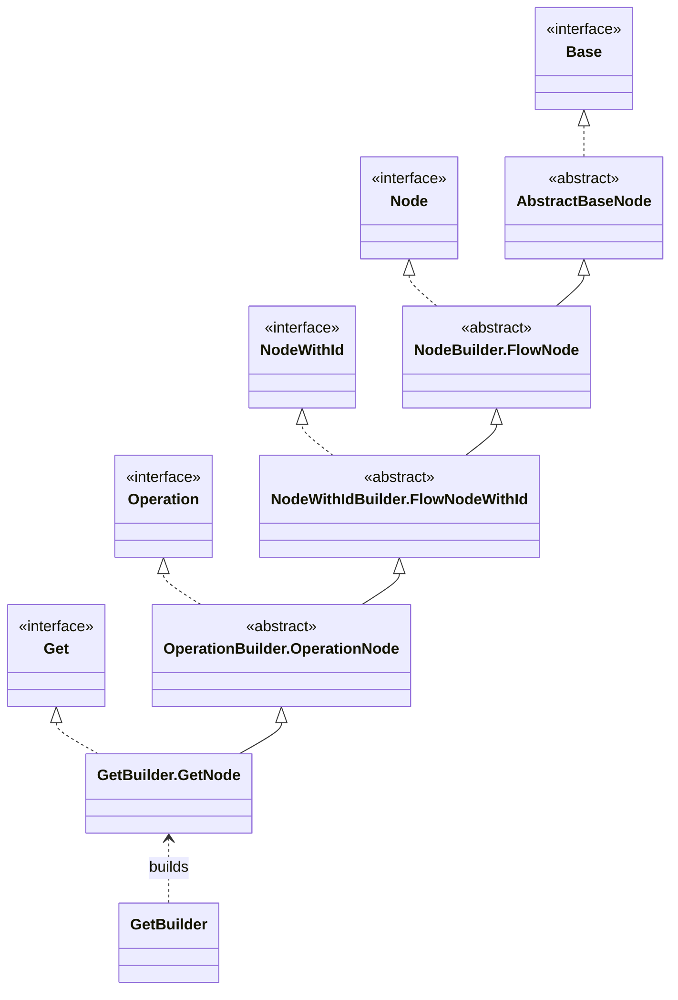
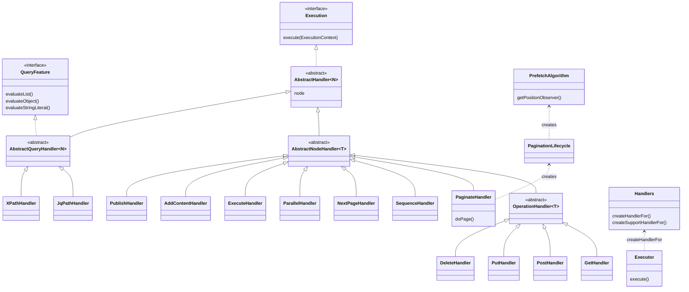
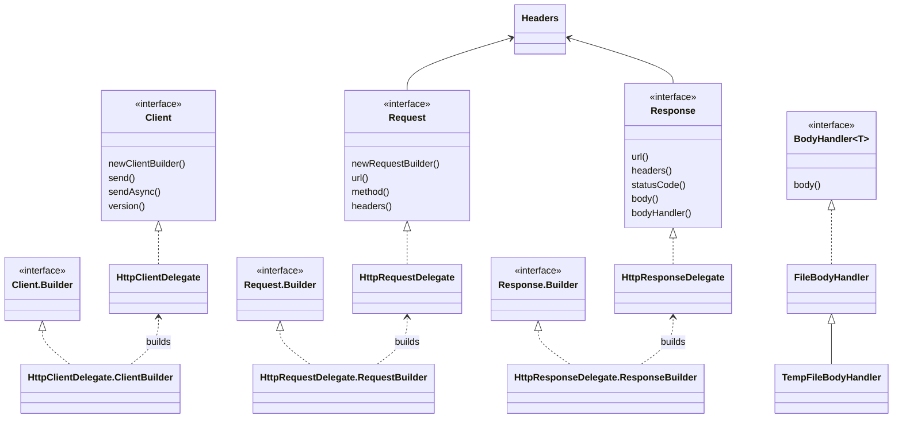
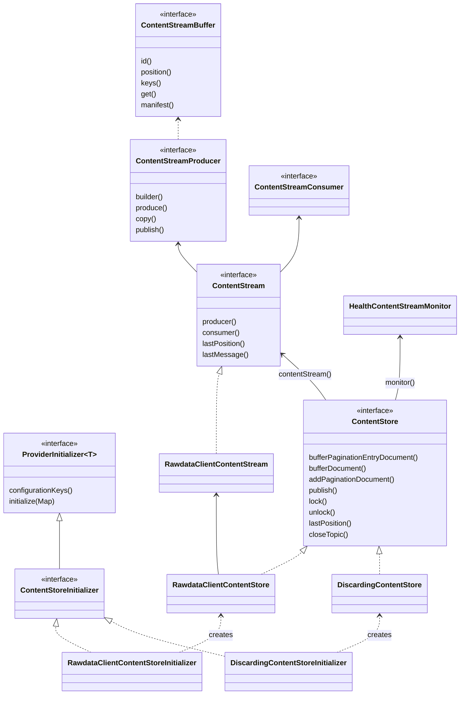

# Architecture

This document describes how Data Collector (dc) 3.0 is built: its modules, how a specification runs, the server, and
the metrics it exports. For the specification format see [Specification DSL](specification-dsl.md). For running the
server see [Getting started](getting-started.md), [REST API](rest-api.md) and [Administration](administration.md). For
building, testing and extending dc see the [Developer guide](developer-guide.md).

- [Overview](#overview)
- [Modules](#modules)
- [Execution model](#execution-model)
- [The server](#the-server)
- [Metrics and monitoring](#metrics-and-monitoring)
- [Class diagrams](#class-diagrams)

## Overview

Data Collector is a specification driven HTTP crawler. A specification is a tree of nodes: operations (`get`, `post`,
`put`, `delete`), `paginate`, `sequence`, `nextPage`, `parallel`, `execute`, `addContent`, `publish` and queries
(JSONPath through jq, XPath, regular expressions, JEXL expressions). A `Worker` runs a specification: it pages through
an API, and publishes each entry as a position on a content stream. A content store connector writes the stream; the
`rawdata` connector writes it to rawdata-client topics. The server runs specifications as tasks over HTTP.

Prerequisites:

- Java 17 or later. Every class file targets Java 17 (`maven.compiler.release` 17). CI builds and tests on JDK 17 and
  JDK 27.
- Docker with Compose v2, to build and run the server image and the setups in [`examples/`](../examples/README.md).
  The image (`data-collector-server/Dockerfile`) is Eclipse Temurin 17 on Ubuntu, for amd64 and arm64.

## Modules

dc is one Maven reactor. Every module has the group `io.descoped.dc` and the version of the root POM. Every module
except `data-collector-testutils` is a named JPMS module.

| Maven artifact | JPMS module | Role |
|---|---|---|
| `data-collector-project` | n/a | Parent and aggregator. Holds the dependency versions as properties. |
| `data-collector-bom` | n/a | BOM. Manages the published dc modules. |
| `data-collector-api` | `io.descoped.dc.api` | The specification DSL (`Builders`, `Specification`, `node`, `node.builder`), the expression language, the execution context, the HTTP client interfaces, the content store SPI, health and metrics interfaces. |
| `data-collector-core` | `io.descoped.dc.core` | The engine: `Worker`, `Executor`, the node handlers, the `java.net.http` client, client certificates, the Maskinporten JWT grant, worker health, the ByteBuddy metrics agents. |
| `data-collector-connector-content-stream-discarding` | `io.descoped.dc.content.discarding` | Content store provider `discarding`: keeps the last published position in memory and drops the content. The engine's default connector. |
| `data-collector-connector-content-stream-rawdata` | `io.descoped.dc.content.rawdata` | Content store provider `rawdata`: writes content to rawdata-client topics, optionally encrypted. |
| `data-collector-server-base` | `io.descoped.dc.application` | The Undertow application: discovery of components, services and controllers, routing, CORS, health, Prometheus metrics. |
| `data-collector-server` | `io.descoped.dc.server` | The server: tasks, integrity check (LMDB), recovery of topics, raw data dump. The `main` class is `io.descoped.dc.server.Server`. |
| `data-collector-testutils` | none (class path) | JUnit harness: embedded test server with mock data, test client, configuration profiles. |
| `data-collector-samples` | none | Example specifications run as tests. Not published. |

### Module dependencies

Solid arrows are `requires` in `module-info.java` (and compile dependencies in the POM). Dashed arrows are Maven
`test` scope dependencies. `data-collector-testutils` and `data-collector-samples` are not JPMS modules; their arrows are
Maven dependencies.

`data-collector-server` also `requires transitive io.descoped.dc.api`. `data-collector-testutils` and
`data-collector-samples` also depend directly on `data-collector-api`, and the samples on core, server-base and the
rawdata connector.

The Descoped libraries each module requires:

| Module | Requires | Run-time providers (POM `runtime` scope) |
|---|---|---|
| `io.descoped.dc.api` | `io.descoped.service.provider.api` (transitive) | |
| `io.descoped.dc.core` | `io.descoped.service.provider.api`, `io.descoped.dynamic.config`, `io.descoped.rawdata.api`, `io.descoped.secrets.api` | secrets `safe-configuration`, `dynamic-configuration` |
| `io.descoped.dc.content.discarding` | `io.descoped.service.provider.api` | |
| `io.descoped.dc.content.rawdata` | `io.descoped.service.provider.api`, `io.descoped.rawdata.api` (transitive), `io.descoped.encryption.util`, `io.descoped.secrets.api` | |
| `io.descoped.dc.application` | `io.descoped.service.provider.api`, `io.descoped.dynamic.config` (transitive), `io.descoped.secrets.api` | |
| `io.descoped.dc.server` | `io.descoped.service.provider.api`, `io.descoped.dynamic.config` (transitive), `io.descoped.rawdata.api`, `io.descoped.secrets.api` | rawdata `filesystem`, `gcs`, `postgres`; secrets `google-secret-manager` |

The providers are never `requires`d. They are found with `ServiceLoader`, through the `uses` their API modules declare.

### Using the BOM

`data-collector-bom` manages `data-collector-api`, `data-collector-core`, both connectors, `data-collector-server-base`,
`data-collector-server` and `data-collector-testutils`. It does not manage third-party versions. See
[Using dc as a library](developer-guide.md#using-dc-as-a-library).

## Execution model

### Specifications and nodes

A specification is built with the DSL in `io.descoped.dc.api.Builders` and `io.descoped.dc.api.Specification`, or
deserialized from JSON or YAML with `Specification.deserialize(String)`. `SpecificationBuilder.end()` builds a
`Specification`: an id, a name, the configurations (`FlowContext`, `Security`) and a start function. Every node is an
immutable object that implements one interface from `io.descoped.dc.api.node` (`Get`, `Paginate`, `Sequence`, and so
on). See [Specification DSL](specification-dsl.md) for each node.

The `FlowContext` holds the specification's global context: variables, request headers and global state, among them
`global.topic`, the topic to write to. A specification built without a context gets the topic `topic`.

### Worker

`io.descoped.dc.core.executor.Worker` runs one specification. `Worker.newBuilder()` returns a `WorkerBuilder`;
`build()` prepares the run:

1. Registers the services every run needs: the `ConfigurationMap`, a `Termination` flag, a `BufferedReordering`, and a
   `FixedThreadPool` of `data.collector.worker.threads` threads (default: available processors + 2).
2. Builds the start node from the `SpecificationBuilder` (or from a single `NodeBuilder`).
3. Creates the HTTP `Client` through `Client.newClientBuilder()`, with the configured HTTP version, redirect policy,
   connect timeout and, when a certificate bundle is selected, its `SSLContext`. See
   [The HTTP client](developer-guide.md#the-http-client).
4. Resolves the topic: the one given to `WorkerBuilder.topic(String)`, else the specification's `FlowContext` topic.
5. Uses the `ContentStore` given to `WorkerBuilder.contentStore(ContentStore)`. Without one, it logs a warning and
   creates one with `ProviderConfigurator.configure(ContentStoreInitializer.class, ...)`, using the provider named by
   `content.stream.connector` (default `discarding`).
6. Builds the root `ExecutionContext`.

`Worker.run()` executes the start node on the calling thread. `Worker.runAsync()` runs it with
`CompletableFuture.supplyAsync`, on the common fork-join pool. A run:

1. Calls each `WorkerObserver.start(WorkerObservable)`.
2. Fills the `HealthWorkerMonitor`, if one is registered in the services (the server registers one per worker).
3. Executes the start node with `Executor.execute(node, context)`.
4. Closes the topic on the content store, unless `keepContentStoreOpenOnWorkerCompletion(true)` was set.
5. Shuts down the thread pool. It waits 5 seconds, then cancels running tasks and waits up to 60 seconds.
6. Sets the `WorkerStatus`: `COMPLETED`, `CANCELED` when a `TerminationException` ended the run, or `FAILED`. On
   `FAILED` the monitor gets a thread dump and the stack trace.
7. Calls each `WorkerObserver.finish(WorkerObservable, WorkerStatus)`, in reverse order.

`Worker.terminate()` sets the `Termination` flag. The pagination loop and the parallel tasks check the flag and throw
`TerminationException`.

### The execution context

`io.descoped.dc.api.context.ExecutionContext` carries data from node to node. It has four parts:

| Part | Content |
|---|---|
| `services()` | A `Services` registry keyed by class: `ConfigurationMap`, `Termination`, `BufferedReordering`, `FixedThreadPool`, `Client`, `ContentStore`, and when present `CertificateFactory` and `HealthWorkerMonitor`. |
| global state | Shared for the whole run: `global.topic`, the request `Headers` given to the worker. |
| `variables()` | Named values that expressions read, such as `${fromPosition}`. |
| state | Per-step values keyed by object or class: the `Response`, the `PageContext`, the `PositionObserver`. `state(key)` falls back to the global state. |

Each handler gets a context and returns a new one. `ExecutionContext.of(context)` copies the variables and state of a
context and shares its services and global state; `merge(context)` copies another context's state and variables into
it. Before a node handler runs, `AbstractNodeHandler.execute` joins the
specification's global context into the input context.

### Node handlers

`io.descoped.dc.core.executor.Executor.execute(node, context)` asks `io.descoped.dc.core.handler.Handlers` for a
handler and calls its `execute(ExecutionContext)`. A handler is a class in the package `io.descoped.dc.core.handler`
annotated with `@Handler(forClass = ...)`, with a constructor that takes the node interface. The first call to
`Handlers` scans that package with ClassGraph and registers every annotated class. A node's handler is looked up by the
first interface the node's class implements. Each call creates a new handler instance.

| Annotation | Purpose | Classes |
|---|---|---|
| `@Handler` | Executes one node type | `GetHandler`, `PostHandler`, `PutHandler`, `DeleteHandler`, `PaginateHandler`, `SequenceHandler`, `NextPageHandler`, `ParallelHandler`, `ForEachHandler`, `ExecuteHandler`, `ProcessHandler`, `AddContentHandler`, `PublishHandler`, `ConsoleHandler`, the query, condition, validator and body publisher handlers |
| `@SupportHandler` | A helper selected by node type and feature | `JqPathParser`, `JsonTokenParser`, `XPathParser`, `XmlTokenParser` (all `DocumentParserFeature`) |
| `@CompositionHandler` | Registered by `Handlers`, used by no class today | none |

Query nodes (`jqpath`, `xpath`, `regex`, `eval`, `body`, `jsonToken`, `xmlToken`) are evaluated through
`io.descoped.dc.core.handler.Queries`: `Queries.from(context, query)` returns a `QueryFeature` with
`evaluateList`, `evaluateObject` and `evaluateStringLiteral`. `Queries.parserFor(queryClass)` returns the
`DocumentParserFeature` that serializes and deserializes a document of that query type.

Expressions (`${...}`) are evaluated by `io.descoped.dc.api.el.ExpressionLanguage`, which uses Apache Commons JEXL. An
expression sees the context variables, `ENV` (the configuration map), `cast` (`ELCast`), `convert` (`ELConvert`) and
`contentStream` (`ELContentStream`, which reads the last position of the topic).

### Operations

`OperationHandler` is the base of `GetHandler`, `PostHandler`, `PutHandler` and `DeleteHandler`. For each request it:

1. Copies the request headers of the context to the request: the headers of the specification context or, when it
   has none, the headers given to the worker with `WorkerBuilder.header(...)`. The two sets are not merged. Then it
   adds the node's own headers, which may hold expressions.
2. Evaluates the URL expressions.
3. Sends the request with `Client.sendAsync` and waits up to `data.collector.http.request.timeout.seconds` seconds
   (default 15).
4. Runs the node's validators (`validate(...)`) on the response.
5. Retries on any exception, up to `data.collector.http.request.retryCount` attempts (default 3), with a pause between
   them. A failed validation is an exception, so it is retried too. With a `retryWhile(...)` rule, `GetHandler`
   repeats the request while the rule matches; only the first rule is used.
6. When the request is a page of a `paginate` with `addPageContent(...)`, writes the response body to the content store
   with `addPaginationDocument`, under the content key `page`. Both connectors write it to the topic `<topic>-pages`.
7. Runs the node's steps (`pipe(...)`) in order, each with the response in its state, and returns the variables named
   in `returnVariables(...)`.

When a `get` has a `sequence` step whose split query is `jsonToken()` or an `XmlToken` query (`new XmlTokenBuilder()`;
`Builders` has no `xmlToken()`), `GetHandler` streams the response body to a temporary file (`TempFileBodyHandler`).
`sequence` and `parallel` then read entries from the file with a token parser instead of holding the whole body in
memory.

### Pagination and prefetch

`paginate` repeats its targets (`iterate(execute(...))`) page by page, until an `until(...)` condition holds or a page
is the end of the stream. `PaginateHandler` evaluates the global context's variables, then hands over to
`PaginationLifecycle`, which keeps a queue of page futures and runs each page on the worker's `FixedThreadPool`.

`PaginationLifecycle` registers a `PositionObserver` in the context state. It is backed by `PrefetchAlgorithm`, which
counts positions:

- `sequence` reports the number of positions a page holds (`expected`).
- `publish` reports the number of positions it has published (`completed`).
- When the pending positions (expected minus completed) fall below the prefetch threshold (`prefetchThreshold(int)`),
  and no prefetch is already waiting for its `sequence` to report, it starts the next page. The next page starts from
  the output of the last page: its returned variables, such as `nextPosition`.

The prefetch threshold is a field of `PaginateBuilder`; it is 0 unless set, and a page is prefetched only when the
pending count is strictly below it.

The main loop polls the page queue. For each page it waits for the page and for all its parallel tasks, then stops when
the page is the end of the stream or the `until` condition holds for the next position variables. A page is the end of
the stream when its `sequence` finds no entries, or when it has no page context.

One pagination cycle:

### Sequence, next page and parallel

- `sequence(splitQuery).expected(positionQuery)` splits the response into entries and reads the position of each.
  It adds the positions, in document order, to the run's `BufferedReordering` and to the page context, and reports the
  count to the `PositionObserver`. No entries means end of stream.
- `nextPage().output(name, query)` reads the variables for the next page from the response and records them in the
  page context.
- `parallel(splitQuery)` splits the response into entries and runs its steps for each entry as a task on the
  `FixedThreadPool`. `variable(name, query)` sets a variable from the entry. The futures are kept in the page context,
  so the pagination loop waits for them. With `data.collector.parallel.queueBuffer.threshold` set, `parallel` waits for
  the running tasks after every that many entries. With a token parser (a temporary file body), it waits after every
  1000 entries.
- `forEach(splitQuery)` runs its steps for each entry of the current body, one after the other, on the calling thread.
- `execute(functionId)` runs another function. `inputVariable(name, query)` sets a variable from the current entry or
  response; `requiredInput(name)` fails the run when a variable is missing.

`WorkerBuilder.stopAtNumberOfIterations(Integer)` makes `parallel` stop after that many entries. The counters behind it
are static fields of `ParallelHandler`, shared by every worker in the JVM.

### The content stream

A content store holds content per topic and position until the position is published:

1. `addContent(positionExpression, contentKey)` buffers content for a position. Inside `parallel`, it buffers the
   entry document (`bufferPaginationEntryDocument`), with the evaluated `storeState(...)` values in its metadata. In a
   function run by `execute` from `parallel`, or inside `forEach`, it buffers the response body (`bufferDocument`).
2. `publish(positionExpression)` checks that the position has buffered content. If it has, it locks the topic, marks
   the position completed in the run's `BufferedReordering`, and publishes the positions that are now in order.
3. `BufferedReordering` releases positions in the order `sequence` registered them. A completed position waits until
   every position before it has completed. Entries finish in any order on the thread pool, but positions are published
   in the order of the source.
4. `ContentStore.publish(topic, positions...)` turns each position's buffers into one message on the topic.

`addPageContent` pages bypass the reordering: they are written to `<topic>-pages` at once.

The content API is in `io.descoped.dc.api.content`: `ContentStore` (buffer, publish, lock, last position, monitor),
`ContentStream` (producers and consumers per topic), `ContentStreamProducer`, `ContentStreamConsumer`,
`ContentStreamBuffer` (a message: id, position, content by key, manifest) and `MetadataContent` (the metadata of one
content item). A `ContentStreamBuffer` id is a UUIDv7, ordered with `TimeOrderedIds.ORDER`.

### Content store connectors

A connector is a `ServiceLoader` provider of `io.descoped.dc.api.content.ContentStoreInitializer`, which extends
`ProviderInitializer<ContentStore>` from service-provider-api. Its class is annotated with `@ProviderName`.
`ProviderConfigurator.configure(ContentStoreInitializer.class, name, configuration)` picks the provider with that name,
checks the keys it requires, and calls `initialize(configuration)`. The name comes from the configuration key
`content.stream.connector`.

| Provider name | Initializer | Required keys | Behaviour |
|---|---|---|---|
| `discarding` | `DiscardingContentStoreInitializer` | none | Remembers the last published position in memory. Content is dropped. Lock and unlock do nothing. |
| `rawdata` | `RawdataClientContentStoreInitializer` | `rawdata.client.provider` | Creates a `RawdataClient` with `RawdataClient.create(configuration)` and writes each published position as one rawdata message. |

The `rawdata` connector:

- Writes one message per published position. The message holds every content key buffered for the position, and a
  `manifest.json` entry: a JSON array with the metadata of each content item.
- Writes `addPageContent` pages to `<topic>-pages` and publishes them at once.
- Encrypts content and manifest with AES-256 (encryption-util) when it finds both an encryption key and salt that are
  not empty. They are read through secrets-client, from the configuration (`rawdata.encryption.key`,
  `rawdata.encryption.salt`), from a properties file, or from Google Secret Manager, depending on
  `rawdata.encryption.provider`. When no key or salt is found, content is written unencrypted. See
  [Administration](administration.md) for the keys.
- Keeps a lock per topic, so concurrent publishes to a topic are serialized.

The server's defaults select the `rawdata` connector with the rawdata-client `memory` provider. The rawdata providers
on the server's module path are `filesystem`, `gcs` and `postgres` (run-time dependencies), plus `memory` and
`discard`, which ship in rawdata-client-api.

## The server

### The application (data-collector-server-base)

`io.descoped.dc.application.server.UndertowApplication.initializeUndertowApplication(...)` builds the application from
a `DynamicConfiguration`:

1. Initializes the Prometheus JVM collectors (`DefaultExports`), unless `prometheus.defaultExports.disabled` is
   `true`.
2. Creates the `MetricsResourceFactory` and `HealthResourceFactory`. Both scan the packages under `io.descoped.dc`
   with ClassGraph for implementations of `MetricsResource` and `HealthResource`.
3. Discovers and creates the components, services and controllers, in that order. Discovery reads every
   `META-INF/services/<interface name>` resource with ClassGraph and loads each listed class with `Class.forName`; it
   does not use `ServiceLoader`, and no `provides` clause is needed.
4. Builds an Undertow server listening on `http.host` and `http.port`, with a CORS handler in front of the dispatcher.

The three extension points are in `io.descoped.dc.application.spi`:

| Interface | Methods | Created with | Lifecycle |
|---|---|---|---|
| `Component` | `initialize()`, `isOpen()`, `getDelegate()`, `close()` | the `DynamicConfiguration`, the `BusinessSSLResourceSupplier`, earlier components | `initialize()` at creation, `close()` at `stop()` |
| `Service` | `isEnabled()`, `start()`, `stop()` | the above, plus `MetricsResourceFactory` and `HealthResourceFactory` | only enabled services are kept; `start()` at `start()`, `stop()` at `stop()` |
| `Controller` | `contextPath()`, `allowedMethods()`, and Undertow's `handleRequest(HttpServerExchange)` | the above, plus the enabled services | handles requests under its context path |

Each class is created by `io.descoped.dc.api.services.ObjectCreator`: it picks the first public constructor whose
parameter types are all registered. See [Extending the server](developer-guide.md#extending-the-server).

Routing (`DispatchController`): a path that starts with `/ping` answers 200. Otherwise the dispatcher takes the first
path segment and passes the request to the controller with the greatest context path that sorts at or before
`/<segment>`. With no such controller it answers 400. The controllers do their own method and path matching.

CORS (`CORSHandler`) reads `http.cors.allow.origin` (a comma separated list of regular expressions, default `.*`),
`http.cors.allow.methods`, `http.cors.allow.header`, `http.cors.allow.credentials` and `http.cors.allow.max-age`.

`server-base` registers two controllers:

- `HealthController` on `/health`, with `/health/alive` and `/health/ready`. `/health` renders every health resource
  that agrees to render for the query parameters, sorted by `@HealthRenderPriority`. The status is `UP` when every
  resource that reports `isUp()` is up. The `configuration` resource masks values whose key contains `pass`, `pwd`,
  `secret`, `credential`, `token` or `encryption`.
- `MetricsController` on `/metrics`: the Prometheus text format of the default `CollectorRegistry`, filtered by
  `name[]` query parameters.

`io.descoped.dc.application.server.Configurations` builds the configuration sources: class path and file properties,
environment variables with a prefix, system properties. Values are literal. See [Administration](administration.md).

The endpoints are described in [REST API](rest-api.md).

### The server (data-collector-server)

`io.descoped.dc.server.Server.main` installs the metrics agent, builds the configuration (in order:
`application-defaults.properties` from the class path, `/conf/application-defaults.properties`,
`/conf/application.properties`, `/conf/application-override.properties`, environment variables with the prefix `DC_`,
system properties) and starts the `UndertowApplication`. When `data.collector.sslBundle.provider` is set, it passes a
`BusinessSSLResourceSupplier` that reads the certificate bundle from Google Secret Manager.

The server registers these classes in `META-INF/services`:

| Kind | Class | Role |
|---|---|---|
| Component | `BusinessSSLResourceComponent` | Holds the `BusinessSSLResourceSupplier`, or null. |
| Component | `ContentStoreComponent` | Creates the server's one `ContentStore` from `content.stream.connector`. |
| Component | `RecoveryContentStoreComponent` | A second `ContentStore` for recovery, created without the encryption key and salt, so encrypted messages are copied as they are. |
| Service | `WorkerService` | Creates and tracks workers. |
| Service | `RawdataFileSystemService` | Enabled by `data.collector.rawdata.dump.enabled`: consumes a topic and writes its messages to files. |
| Service | `IntegrityCheckService` | Integrity check jobs. |
| Service | `RecoveryService` | Recovery jobs. |
| Controller | `TaskController` | `/tasks` |
| Controller | `IntegrityCheckController` | `/check-integrity` |
| Controller | `RecoveryController` | `/recovery` |

Tasks: `TaskController` deserializes a specification from the body of `PUT /tasks` and calls
`WorkerService.createOrRejectTask`. Only one worker may run per specification id; a second is rejected with 409.
`WorkerService` builds a `Worker` with the server configuration, the shared `ContentStore`, a `WorkerObserver`, and
either the certificate directory `data.collector.certs.directory` (default: the working directory) or the Google Secret
Manager supplier. `WorkManager` runs it with `Worker.runAsync()`. On start, the observer registers a
`HealthWorkerResource` for the worker; on finish, it moves it to the worker history. `DELETE /tasks/<id>` terminates the
worker.

Integrity check: `IntegrityCheckService` starts a job per topic. The job consumes the topic up to its last position,
writes each message's id and position to an LMDB database (`IntegrityCheckIndex`), then reads the index in order and writes a
JSON report of positions that occur more than once, and a summary. The database and reports live under
`data.collector.integrityCheck.database.location` (default `lmdb` in the working directory), one directory per topic.

Recovery: `RecoveryWorker` reads the first and last position of a topic from its integrity check database, copies the
topic's messages from the `ContentStore` to a target topic on the recovery content store, publishing every 1000
positions. It then reads the target topic from the last recovered message's timestamp and writes the positions it
finds to `tail-report.json`.

## Metrics and monitoring

### Prometheus metrics

`io.descoped.dc.core.metrics.MetricsAgent.premain(String, Instrumentation)` installs two ByteBuddy agents.
`Server.main` calls it with `ByteBuddyAgent.install()`; the server image also starts the JVM with
`-javaagent:<byte-buddy-agent jar>`. A library user who wants these metrics calls `MetricsAgent.premain` the same way.

- `HttpClientAgent` intercepts `send` and `sendAsync` on every `io.descoped.dc.api.http.Client` implementation
  (`HttpClientExporter.Send`, `HttpClientExporter.SendAsync`), and `execute` on `GetHandler`
  (`HttpClientExporter.GetHandlerInterceptor`, which counts failures of the whole GET step).
- `ContentStoreAgent` intercepts `addPaginationDocument`, `bufferPaginationEntryDocument`, `bufferDocument` and
  `publish` on every `ContentStore` implementation (`ContentStoreExporter`).

| Metric | Type | Labels | Measures |
|---|---|---|---|
| `dc_client_request_started` | counter | `location` | Requests started |
| `dc_client_request_completed` | counter | `location`, `statusCode`, `emptyResponse` | Requests that returned a response |
| `dc_client_request_failure` | counter | `location` | Requests that failed, and GET steps that threw |
| `dc_client_request_duration` | histogram | `location` | Request duration in seconds |
| `dc_content_stream_pagination_page_publish_count` | counter | `topic` | Pages written with `addPaginationDocument` |
| `dc_content_stream_pagination_page_publish_duration` | histogram | `topic` | Duration of `addPaginationDocument` |
| `dc_content_stream_buffer_pagination_entry_count` | counter | `topic` | Entries buffered |
| `dc_content_stream_buffer_entry_document_count` | counter | `topic` | Documents buffered |
| `dc_content_stream_pagination_entry_publish_position_count` | counter | `topic` | Positions published |
| `dc_content_stream_pagination_entry_publish_position_duration` | histogram | `topic` | Duration of `publish` |
| `dc_application_since` | gauge | | Start time of the application, in epoch milliseconds |
| `dc_application_uptime` | gauge | | Set only by `MetricsApplicationResource.trackUptime()`, which no main code calls, so it stays 0 |

`location` is the scheme, host and (when not 80 or 443) port of the request URL. The Prometheus client (simpleclient
0.16) adds `_total` to counter names in the text format, and `_bucket`, `_count` and `_sum` to histograms. The JVM
collectors of `DefaultExports` are also exported.

### Health

Health resources implement `io.descoped.dc.api.health.HealthResource` and are rendered by `/health`:

| Resource | Name | Module | Rendered |
|---|---|---|---|
| `HealthApplicationResource` | `application` | server-base | always |
| `HealthModuleInfoResource` | `modules` | server-base | always |
| `HealthConfigResource` | `configuration` | server-base | with `config` or `all` |
| `HealthContextsResource` | `contexts` | server-base | with `contexts` or `all` |
| `HealthRuntimeInfoResource` | `runtime` | server-base | with `runtime` or `all` |
| `HealthWorkerResource` | `worker-<id>` | core | one per running worker, added by `WorkerService` |
| `HealthWorkerHistoryResource` | `worker-history` | core | always |
| `HealthThreadsResource` | `thread-info` | core | with `threads` or `all` |

A worker's `HealthWorkerMonitor` records its specification, status, timestamps, thread pool, request counts and
durations, retries, prefetch counts, expected and completed positions, the first and last published position, and the
content store's `HealthContentStreamMonitor` (counts, sizes and write durations of pages, entries, documents and
publishes).

## Class diagrams

The diagrams show the main types and their relations. They leave out most methods.

### DSL nodes

The node interfaces in `io.descoped.dc.api.node` that control the flow:

The queries, conditions, validators and request bodies:

`JwtIdentity` extends `Identity`. `FlowContext` and `Security` extend `Configuration`, which is not a `Base`.

### DSL builders

The builders in `io.descoped.dc.api.node.builder`. `SpecificationBuilder` collects the functions by id and builds them.
`NodeBuilderDeserializer` reads them from JSON.

Each builder builds a node class nested in it. For example, `GetBuilder.build` returns a `GetNode`:

### Handlers

The handler hierarchy in `io.descoped.dc.core.handler`, and how pagination uses it:

### HTTP client

The client abstractions in `io.descoped.dc.api.http` and their `java.net.http` implementation in
`io.descoped.dc.core.http`. The implementations are registered with `provides` in `io.descoped.dc.core` and found
with `ServiceLoader` (`uses` in `io.descoped.dc.api`).

`FileBodyHandler` and `TempFileBodyHandler` are in `io.descoped.dc.core.handler`.

### Content store

