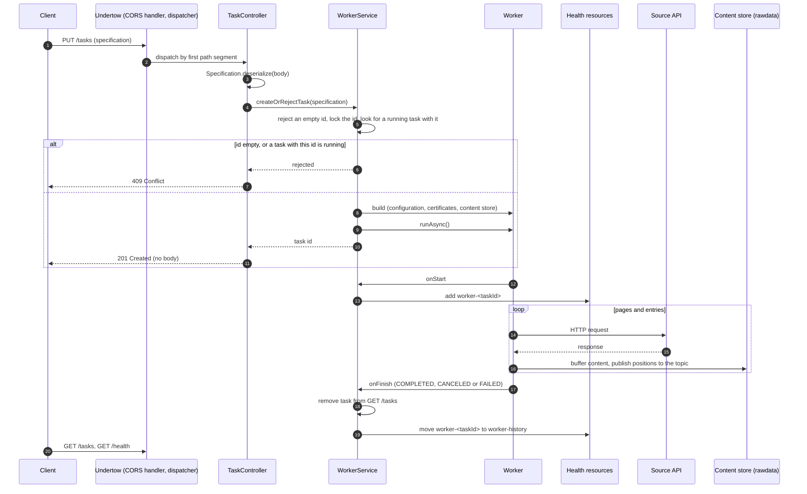

# REST API

The Data Collector server answers HTTP on one port (`http.port`, 9990 in the image). This page lists every endpoint the
server registers, with the parameters, bodies and status codes the code gives them.

- [Overview](#overview)
- [Authentication and CORS](#authentication-and-cors)
- [Routing and errors](#routing-and-errors)
- [Submitting and running a task](#submitting-and-running-a-task)
- [Tasks](#tasks)
- [Health](#health)
- [Ping](#ping)
- [Metrics](#metrics)
- [Integrity check](#integrity-check)
- [Recovery](#recovery)
- [Test facility: the mock data API](#test-facility-the-mock-data-api)

## Overview

| Method | Path | Purpose | Module |
|---|---|---|---|
| `PUT` | `/tasks` | Start a task from a specification | data-collector-server |
| `GET` | `/tasks` | List running tasks | data-collector-server |
| `DELETE` | `/tasks/{taskId}` | Cancel a running task | data-collector-server |
| `GET` | `/health` | Health report | data-collector-server-base |
| `GET` | `/health/alive` | Liveness | data-collector-server-base |
| `GET` | `/health/ready` | Readiness | data-collector-server-base |
| any | `/ping` | Answers 200 | data-collector-server-base |
| `GET` | `/metrics` | Prometheus metrics | data-collector-server-base |
| `GET` | `/metrics/-/healthy` | Exporter check | data-collector-server-base |
| `PUT` | `/check-integrity/{topic}` | Start an integrity check of a topic | data-collector-server |
| `GET` | `/check-integrity` | List integrity checks | data-collector-server |
| `GET` | `/check-integrity/{topic}` | Summary of a check | data-collector-server |
| `GET` | `/check-integrity/{topic}/full` | Summary with the duplicate positions | data-collector-server |
| `DELETE` | `/check-integrity/{topic}` | Stop a running check | data-collector-server |
| `PUT` | `/recovery/{topic}?toTopic={target}` | Copy an indexed topic to a new topic | data-collector-server |
| `GET` | `/recovery` | List topics that have an index | data-collector-server |
| `GET` | `/recovery/{topic}` | Summary of a recovery | data-collector-server |
| `DELETE` | `/recovery/{topic}` | Stop a running recovery | data-collector-server |

Controllers are found at start-up from the `META-INF/services/io.descoped.dc.application.spi.Controller` files of the
jars on the module path and class path.
The server logs each one (`Registered controller: /tasks -> ...`), and `GET /health?contexts` lists them.

JSON responses are pretty-printed by Jackson.

## Authentication and CORS

**Authentication.** No endpoint checks credentials. The server reads no `Authorization` header and has no user or
token configuration. Anyone who can reach the HTTP port can start and cancel tasks, start integrity checks and
recoveries, and read the health report, including the configuration (`?config`) and thread dumps (`?threads`).

**CORS.** Every request passes a CORS handler before it reaches an endpoint. It is configured with the
`http.cors.allow.*` keys ([configuration reference](administration.md#http-server-and-cors)):

| Key | Default in code and in `application-defaults.properties` |
|---|---|
| `http.cors.allow.origin` | `.*` |
| `http.cors.allow.methods` | `POST,GET,PUT,DELETE,HEAD` |
| `http.cors.allow.header` | `Content-Type,Authorization` |
| `http.cors.allow.credentials` | `false` |
| `http.cors.allow.max-age` | `900` |

`http.cors.allow.origin` is a comma-separated list of regular expressions; an `Origin` matches when one of them matches
it in full. With the default `.*`, every origin matches. The handler works like this:

- A request without an `Origin` header, or whose `Origin` does not match, goes to the endpoint unchanged, without CORS
  headers. It is not rejected.
- A request with a matching `Origin` that is not `OPTIONS` goes to the endpoint, and the response gets
  `Access-Control-Allow-Origin: <the request's Origin>`, `Vary: Origin`, and `Access-Control-Expose-Headers` with the
  allowed headers. With `http.cors.allow.credentials=true` it also gets `Access-Control-Allow-Credentials: true`.
- A preflight (`OPTIONS` with a matching `Origin`, one `Access-Control-Request-Method` in the allowed methods, and
  every name in `Access-Control-Request-Headers` in the allowed headers) is answered by the handler with
  `204 No Content`, `Access-Control-Allow-Origin`, `Vary: Origin`, `Access-Control-Max-Age`,
  `Access-Control-Allow-Methods` and `Access-Control-Allow-Headers`. A preflight that fails one of these checks goes to
  the endpoint as an ordinary `OPTIONS` request, which every endpoint except `/ping` answers with `400`.

```sh
curl -i -X OPTIONS localhost:9990/tasks \
  -H 'Origin: https://console.example.org' \
  -H 'Access-Control-Request-Method: PUT' \
  -H 'Access-Control-Request-Headers: Content-Type'
```

```http
HTTP/1.1 204 No Content
Access-Control-Allow-Origin: https://console.example.org
Vary: Origin
Access-Control-Max-Age: 900
Access-Control-Allow-Methods: POST,GET,PUT,DELETE,HEAD
Access-Control-Allow-Headers: Content-Type,Authorization
```

Headers that do not concern CORS are left out above. The order of the names in the two `Allow` lists may differ: they
are kept in a set.

## Routing and errors

A path that starts with `/ping` is answered by the ping endpoint, whatever the method. Any other request is routed by
its first path segment to the controller with the greatest context path that is not greater than `/<segment>`, in
string order. Each controller then matches the method and the full path itself.

| Situation | Response |
|---|---|
| No controller sorts at or below the first segment (for example `/`, `/api` or `/abc` in the image) | `400`, `Content-Type: text/plain`, body `Unsupported namespace: "<path without the leading slash>"` |
| A controller gets a method or path it does not handle | `400`, empty body |
| An exception escapes the task, health, metrics or integrity check controller | Undertow's handling of an unhandled exception: `500` when the response has not started |
| An exception in the recovery controller, including a path or method it has no binding for | `400`, empty body; the error is logged |

## Submitting and running a task

`PUT /tasks` returns as soon as the worker is built and started. The worker runs asynchronously, with its own fixed
thread pool for requests and entries, and reports to the health report while it runs.



## Tasks

A task runs one specification. The server runs at most one task per specification `id` at a time. Task ids are UUIDv7
values.

### PUT /tasks

Start a task.

| | |
|---|---|
| Path parameters | none |
| Query parameters | none |
| Headers | none are read; `Content-Type: application/json` is customary |
| Request body | a specification, as JSON (see [Specification DSL](specification-dsl.md)). The body is parsed with Jackson's YAML parser, so YAML is accepted too. |
| Response body | none |

| Status | When |
|---|---|
| `201 Created` | The worker was built and started. The response does not carry the task id; use `GET /tasks`. |
| `409 Conflict` | The specification `id` is empty, or a task with the same specification `id` is running. |
| `500 Internal Server Error` | The body cannot be parsed as a specification, or the worker cannot be built from it (for example a certificate bundle that cannot be loaded). The controller does not catch these exceptions. |
| `400 Bad Request` | The path is not exactly `/tasks`. |

```sh
curl -X PUT -i localhost:9990/tasks \
  -H 'content-type: application/json' \
  -d @examples/specs/enhetsregisteret-test-spec.json
```

Every task gets the whole server configuration, its own fixed thread pool (`data.collector.worker.threads`) and an HTTP
client configured from the `data.collector.http.*` keys. Certificates come from `data.collector.certs.directory`, or
from Google Secret Manager when `data.collector.sslBundle.provider` is set. See
[Administration](administration.md#configuration-reference).

### GET /tasks

List the running tasks. A task leaves the list when it completes, fails or is canceled.

| | |
|---|---|
| Parameters | none |
| Response | `200 OK`, `Content-Type: application/json`: an array of tasks, `[ ]` when none runs |

| Field | Meaning |
|---|---|
| `task-id` | the worker id (UUIDv7) |
| `specification-id` | the specification's `id` |
| `description` | the specification's `name` |

```sh
curl localhost:9990/tasks
```

```json
[ {
  "task-id" : "019aa1d2-7c3e-7b41-a1f0-5c2d9e8b3f60",
  "specification-id" : "Enhetsregisteret",
  "description" : "Collect enhetsregiseret"
} ]
```

### DELETE /tasks/{taskId}

Ask a running task to stop. The worker stops asynchronously and ends with status `CANCELED` in `worker-history`.

| Parameter | In | Meaning |
|---|---|---|
| `taskId` | path | the `task-id` from `GET /tasks` |

| Status | When |
|---|---|
| `200 OK` | The task was found and asked to stop. Empty body. |
| `400 Bad Request` | No running task has this id (it may have finished), or the path is not `/tasks/{taskId}`. |
| `500 Internal Server Error` | `taskId` is not a UUID. |

```sh
curl -X DELETE -i localhost:9990/tasks/019aa1d2-7c3e-7b41-a1f0-5c2d9e8b3f60
```

## Health

### GET /health

The health report, as JSON. It is always answered with `200 OK`; the field `status` is `UP` or `DOWN`.

Query parameters are flags: only their presence counts, not their value.

| Parameter | Adds |
|---|---|
| `config` | `configuration`: every configuration key and value. Values of keys whose name contains `pass`, `pwd`, `secret`, `credential`, `token` or `encryption` (any case) are shown as `************`. |
| `contexts` | `contexts`: the registered controllers, their context paths and methods |
| `runtime` | `runtime`: available processors, free, max and total memory in MB |
| `threads` | `thread-info`: every thread by thread group, with state and stack trace |
| `all` | all of the above |

The sections, in the order they are written:

| Field | Shown | Content |
|---|---|---|
| `status` | always | `UP` when every resource that reports a state is up: the application is `RUNNING` and no running task's content stream is closed; else `DOWN` |
| `application` | always | `status` (`INITIALIZING`, `INITIALIZED`, `RUNNING`, `SHUTTING_DOWN`, `SHUTDOWN`), `host`, `port`, `since`, `now`, `uptime` |
| `worker-<taskId>` | one per running task | `status` (`RUNNING`), `worker-id`, `specificationId`, `name`, `started`, `duration`, `start-function`, `start-function-id`, `security`, `request-info`, `content-stream`, `thread-pool` |
| `worker-history` | always | the reports of finished tasks, newest first, with `status` `COMPLETED`, `CANCELED` or `FAILED` and `ended`; a `FAILED` report also has `failure-cause` (the stack trace) and `thread-dump`. At most 26 reports are kept; once the list is full, only its newest report is replaced. |
| `modules` | always | the `io.descoped*` modules on the module path with Maven group, artifact and version |
| `configuration` | `config`, `all` | see above |
| `contexts` | `contexts`, `all` | see above |
| `runtime` | `runtime`, `all` | see above |
| `thread-info` | `threads`, `all` | see above |

`request-info.request-headers` lists the request headers the specification sets globally, with their values.

| Status | When |
|---|---|
| `200 OK` | `GET /health` |
| `400 Bad Request` | Another method, or a path under `/health` other than `/health`, `/health/alive` and `/health/ready`. Empty body. |

```sh
curl 'localhost:9990/health'
curl 'localhost:9990/health?config&runtime'
curl 'localhost:9990/health?all'
```

Example while the Enhetsregisteret specification runs (abbreviated: `content-stream` and `modules` are shortened):

```json
{
  "status" : "UP",
  "application" : {
    "status" : "RUNNING",
    "host" : "0.0.0.0",
    "port" : 9990,
    "since" : "2026-11-20T09:12:03.512Z",
    "now" : "2026-11-20T09:13:41.077Z",
    "uptime" : "0 days, 0 hours, 1 minutes, 37 seconds, 565 millis"
  },
  "worker-019aa1d2-7c3e-7b41-a1f0-5c2d9e8b3f60" : {
    "status" : "RUNNING",
    "worker-id" : "019aa1d2-7c3e-7b41-a1f0-5c2d9e8b3f60",
    "specificationId" : "Enhetsregisteret",
    "name" : "Collect enhetsregiseret",
    "started" : "2026-11-20T09:13:02.441Z",
    "duration" : "0 days, 0 hours, 0 minutes, 38 seconds, 636 millis",
    "start-function" : "io.descoped.dc.api.node.Paginate",
    "start-function-id" : "loop-pages-until-done",
    "security" : {
      "ssl-bundle-name" : null
    },
    "request-info" : {
      "http-client-timeout-seconds" : 3600,
      "http-request-timeout-seconds" : 3600,
      "request-headers" : {
        "accept" : [ "application/json" ]
      },
      "request-count" : 212,
      "avg-requests-per-second" : 5.58,
      "last-request-duration-millis" : 143,
      "avg-request-duration-millis" : 151,
      "retry-on-failure-count" : 0,
      "prefetch-threshold" : 30,
      "prefetch-count" : 12,
      "expected-count" : 4240,
      "completed-count" : 4220
    },
    "content-stream" : {
      "topic" : "enhetsregister",
      "start-position" : "810034882",
      "last-position" : "923609016",
      "last-seen" : "2026-11-20T09:13:41.002Z",
      "published-position-count" : 4220
    },
    "thread-pool" : {
      "core-pool-size" : 20,
      "maximum-pool-size" : 20
    }
  },
  "worker-history" : [ ],
  "modules" : [ {
    "moduleName" : "io.descoped.dc.api",
    "groupId" : "io.descoped.dc",
    "artifactId" : "data-collector-api",
    "version" : "3.0.0"
  } ]
}
```

### GET /health/alive

| | |
|---|---|
| Parameters | none |
| Response | `200 OK`, empty body, whenever the server answers |

```sh
curl -i localhost:9990/health/alive
```

### GET /health/ready

| | |
|---|---|
| Parameters | none |
| Response | empty body |

| Status | When |
|---|---|
| `200 OK` | Every resource that reports a state is up: the application is `RUNNING`, and no running task's content stream is closed. |
| `503 Service Unavailable` | Otherwise. |

```sh
curl -i localhost:9990/health/ready
```

## Ping

### /ping

Any request whose path starts with `/ping` is answered with `200 OK` and an empty body, whatever the method. It does
not touch any other part of the server.

```sh
curl -i localhost:9990/ping
```

## Metrics

### GET /metrics

The Prometheus text format, version 0.0.4, from the default Prometheus `CollectorRegistry`. The controller serves every
`GET` path that starts with `/metrics`.

| Parameter | In | Meaning |
|---|---|---|
| `name[]` | query, repeatable | Return only the samples with these names, as written in the output (for example `dc_client_request_started_total` or `dc_client_request_duration_count`; a family name such as `dc_client_request_duration` alone matches nothing). Without it, everything is returned. |

| | |
|---|---|
| Response | `200 OK`, `Content-Type: text/plain; version=0.0.4; charset=utf-8` |
| Other methods | `400 Bad Request` |

```sh
curl localhost:9990/metrics
curl -g 'localhost:9990/metrics?name[]=dc_client_request_started_total&name[]=dc_client_request_duration_count'
```

The metric families are listed in [Administration: metrics and profiling](administration.md#metrics-and-profiling).

### GET /metrics/-/healthy

`200 OK` with the body `Exporter is Healthy.` and the same content type.

```sh
curl localhost:9990/metrics/-/healthy
```

## Integrity check

An integrity check reads a topic from its first message until it reaches the topic's last position (or until no
message arrives for `data.collector.integrityCheck.consumer.timeoutInSeconds`, 15 by default). It writes every message
id and position to an LMDB index in `<data.collector.integrityCheck.database.location>/<topic>`, then reports the
positions that occur more than once. One check per topic runs at a time. See
[Administration: integrity check and recovery](administration.md#integrity-check-and-recovery).

The topic is the path segment as given; it is used as a directory name under the LMDB location.

A check's summary:

| Field | Meaning |
|---|---|
| `topic` | the topic |
| `status` | `RUNNING` or `CLOSED` |
| `started` | when the check started |
| `ended` | when it ended; `1970-01-01T00:00:00Z` while it runs |
| `since` | time since `started` |
| `firstPosition` | the first position read |
| `lastPosition` | the topic's last position when the check started (or the last position read, when the topic reported none) |
| `currentPosition` | the last position read so far |
| `checkedPositions` | messages read |
| `averageCheckedPositionsPerSecond` | `checkedPositions` divided by the seconds since `started` |
| `duplicatePositions` | the number of messages at positions that occur more than once |
| `affectedPositions` | the number of positions that occur more than once |

### PUT /check-integrity/{topic}

Start a check. A previous index of the topic is deleted first.

| Status | When |
|---|---|
| `201 Created` | The check started. Empty body. |
| `409 Conflict` | A check of this topic is running. |
| `400 Bad Request` | The path is not `/check-integrity/{topic}`. |

```sh
curl -X PUT -i localhost:9990/check-integrity/enhetsregister
```

### GET /check-integrity

List the checks: those held in memory since the server started, with their status, and one entry with status
`CLOSED` for every index directory under the LMDB location.

| | |
|---|---|
| Response | `200 OK`, `Content-Type: application/json`; `500` while the LMDB location does not exist (before the first check) |

```sh
curl localhost:9990/check-integrity
```

```json
[ {
  "topic" : "enhetsregister",
  "status" : "CLOSED"
} ]
```

### GET /check-integrity/{topic}

The summary of a check. A check held in memory (started since the server started) gives its live summary. For a
check known only from its index directory, the server tries to read `<LMDB location>/<topic>/report/summary.json`;
the summary class has no constructor Jackson can use, so reading it fails and the request ends with `500`.

| Status | When |
|---|---|
| `200 OK` | The summary of a check held in memory, as JSON. |
| `400 Bad Request` | No check of this topic is known, in memory or on disk. |
| `404 Not Found` | The check is known only on disk, and its directory has no `report/summary.json`. |
| `500 Internal Server Error` | The check is known only on disk, and `report/summary.json` exists (see above), or the LMDB location does not exist yet. |

```sh
curl localhost:9990/check-integrity/enhetsregister
```

```json
{
  "topic" : "enhetsregister",
  "status" : "CLOSED",
  "started" : "2026-11-20T09:20:11.204Z",
  "ended" : "2026-11-20T09:20:14.870Z",
  "since" : "0 days, 0 hours, 0 minutes, 9 seconds, 112 millis",
  "firstPosition" : "810034882",
  "lastPosition" : "999999999",
  "currentPosition" : "999999999",
  "checkedPositions" : 9980,
  "averageCheckedPositionsPerSecond" : 1108.89,
  "duplicatePositions" : 2,
  "affectedPositions" : 1
}
```

### GET /check-integrity/{topic}/full

The summary followed by `duplicates`: an array with one object per duplicated position, mapping the position to the
ids of its messages in time order. The server writes this document once to `<LMDB location>/<topic>/report/<topic>.json`
and streams that file on later requests.

| Status | When |
|---|---|
| `200 OK` | `Content-Type: application/json`. |
| `400 Bad Request` | No check of this topic is known, or the path is not `/check-integrity/{topic}/full`. |
| `500 Internal Server Error` | The check is still running (its report does not exist yet), or it is known only on disk (the summary cannot be read back, as for `GET /check-integrity/{topic}`), or the LMDB location does not exist yet. |

`GET` paths under `/check-integrity/` that end in `full` are handled here, so a topic whose name ends in `full` cannot
be read with `GET /check-integrity/{topic}`.

```sh
curl localhost:9990/check-integrity/enhetsregister/full
```

```json
{
  "topic" : "enhetsregister",
  "status" : "CLOSED",
  "started" : "2026-11-20T09:20:11.204Z",
  "ended" : "2026-11-20T09:20:14.870Z",
  "since" : "0 days, 0 hours, 0 minutes, 9 seconds, 112 millis",
  "firstPosition" : "810034882",
  "lastPosition" : "999999999",
  "currentPosition" : "999999999",
  "checkedPositions" : 9980,
  "averageCheckedPositionsPerSecond" : 1108.89,
  "duplicatePositions" : 2,
  "affectedPositions" : 1
 ,"duplicates" : [ {
      "915933149" : [ "019aa1d3-0b52-7c11-8a3e-2f4b6d8e1a90", "019aa1d4-5e71-7f02-9b44-7c1d2e3f4a5b" ]
    } ]
}
```

The layout (the comma before `duplicates`, the indentation) is as the server writes it.

### DELETE /check-integrity/{topic}

Stop a running check. The check stops reading, writes its report and summary, and ends as `CLOSED`.

| Status | When |
|---|---|
| `200 OK` | The check was asked to stop. Empty body. |
| `400 Bad Request` | No check of this topic is running. |

```sh
curl -X DELETE -i localhost:9990/check-integrity/enhetsregister
```

## Recovery

Recovery copies a topic to a new topic, using the index an integrity check built for the source topic. It reads the
source topic from its first message and copies each message, unchanged, to the target topic, publishing in batches of
1 000 positions. It stops after one message, the stop message, which it finds in the index: it walks the duplicated
positions in index key order, takes the first message (oldest id) of each, keeps the oldest found so far, and ends the
walk at the first position whose first message is not older. Afterwards recovery reads the target topic from the time of
the last copied message and writes the positions it finds to `<LMDB location>/<target>/report/tail-report.json` (the
post-check).

The index must hold at least one duplicated position. Without one there is no stop message, and the copy fails at the
first message it reads; the failure is logged and the summary shows `COMPLETED` with no copied positions.

The target topic is written through a second content store with the same configuration, except that
`rawdata.encryption.key` and `rawdata.encryption.salt` are removed, so already encrypted content is not encrypted
twice, and `local-temp-folder` gets the suffix `-recovery`. See
[Administration: integrity check and recovery](administration.md#integrity-check-and-recovery).

The path parameters are used as given.

### PUT /recovery/{topic}?toTopic={target}

Start a recovery of `topic` into `target`.

| Parameter | In | Meaning |
|---|---|---|
| `topic` | path | the source topic; it must have an index from an integrity check |
| `toTopic` | query, required | the target topic |

| Status | When |
|---|---|
| `201 Created` | The recovery started. Empty body. |
| `409 Conflict` | A recovery of this source topic is running. |
| `400 Bad Request` | `toTopic` is missing, the LMDB location does not exist, or the request fails otherwise. |

```sh
curl -X PUT -i 'localhost:9990/recovery/enhetsregister?toTopic=enhetsregister-recovered'
```

### GET /recovery

The names of the index directories under the LMDB location, that is the topics that can be recovered (and targets of
earlier recoveries, which get a `report` directory there).

| Status | When |
|---|---|
| `200 OK` | `Content-Type: application/json`, an array of names. |
| `400 Bad Request` | The LMDB location cannot be listed. |

```sh
curl localhost:9990/recovery
```

```json
[ "enhetsregister" ]
```

### GET /recovery/{topic}

The summary of the recovery of `topic` started since the server started.

| Status | When |
|---|---|
| `200 OK` | `Content-Type: application/json`, the summary. |
| `400 Bad Request` | No recovery of this topic is known. |

| Field | Meaning |
|---|---|
| `status` | `RUNNING` or `COMPLETED` |
| `started`, `ended`, `since` | start, end (`1970-01-01T00:00:00Z` while running) and time since start |
| `startPosition`, `lastPosition` | the first position in the index, and the position the copy stops after |
| `currentPosition` | the last position read |
| `indexDatabasePath` | the index directory of the source topic, as a `file:` URI |
| `sourceTopic`, `targetTopic` | the topics |
| `bufferedPositions` | positions copied but not yet published |
| `copiedPositions` | positions published to the target topic |
| `averageCopiedPositionsPerSecond` | `copiedPositions` divided by the seconds since `started` |
| `postCheckFromTimestamp`, `postCheckStartPosition`, `postCheckLastPosition`, `postCheckCheckedPositions` | the post-check of the target topic |

```sh
curl localhost:9990/recovery/enhetsregister
```

```json
{
  "status" : "COMPLETED",
  "started" : "2026-11-20T09:31:05.017Z",
  "ended" : "2026-11-20T09:31:07.388Z",
  "since" : "0 days, 0 hours, 0 minutes, 4 seconds, 902 millis",
  "startPosition" : "810034882",
  "currentPosition" : "915933149",
  "lastPosition" : "915933149",
  "indexDatabasePath" : "file:///opt/dc/lmdb/enhetsregister/",
  "sourceTopic" : "enhetsregister",
  "targetTopic" : "enhetsregister-recovered",
  "bufferedPositions" : 0,
  "copiedPositions" : 6120,
  "averageCopiedPositionsPerSecond" : 1530.0,
  "postCheckFromTimestamp" : "2026-11-20T09:13:22.817Z",
  "postCheckStartPosition" : "915933149",
  "postCheckLastPosition" : "915933149",
  "postCheckCheckedPositions" : 1
}
```

### DELETE /recovery/{topic}

Stop a running recovery.

| Status | When |
|---|---|
| `200 OK` | The recovery was asked to stop. Empty body. |
| `404 Not Found` | No recovery of this topic is running. |

```sh
curl -X DELETE -i localhost:9990/recovery/enhetsregister
```

## Test facility: the mock data API

`data-collector-testutils` has a controller with the context path `/api` that serves generated feed data (for example
`/api/events`) to tests. It is registered only when testutils is on the class path, as in the embedded test servers of
the module tests. It is not in the server image, where `/api` is answered with `400 Unsupported namespace`.
